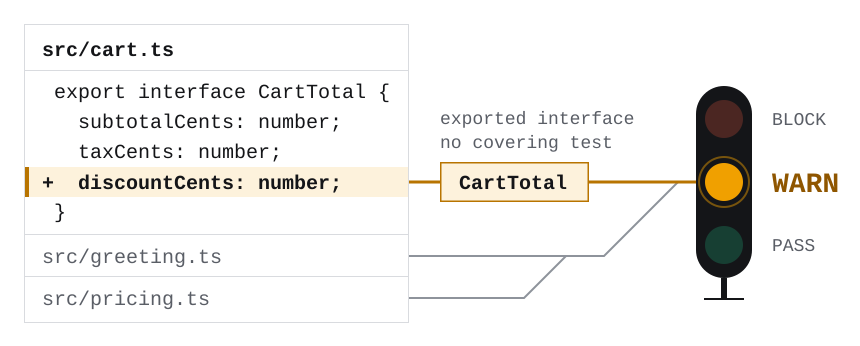
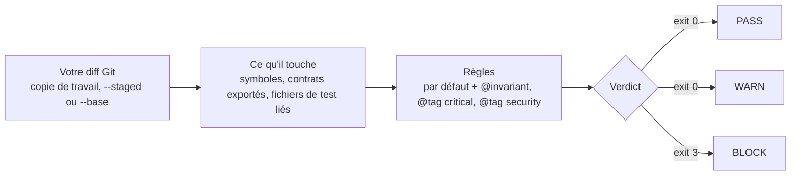
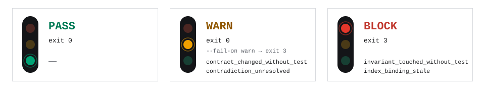

[English](README.md) · Français

# semctx

semctx lit le diff Git d’un dépôt TypeScript et montre quels contrats exportés, quelles règles
déclarées et quels tests le changement touche. Il conclut par un seul verdict : PASS, WARN ou BLOCK.
Par défaut, BLOCK sort avec le code 3, ce qui permet à un hook Git, à un job de CI ou à un agent de code
d’arrêter le changement.

[](https://www.npmjs.com/package/semctx)
[](https://github.com/hoklims/semctx/actions/workflows/ci.yml)
[](LICENSE)

<picture>
  <source media="(prefers-color-scheme: dark)" srcset="docs/assets/readme/hero-dark.svg">
  
</picture>

L’analyse tourne sur votre machine. Elle lit vos fichiers et votre historique Git local, sans
appeler de LLM ni de service réseau. Pour l’essayer sur votre code, partez d’une copie de travail
propre, dans un dépôt qui compte au moins un commit, avec une version récente de
[Bun](https://bun.sh) :

```sh
bunx semctx@latest setup          # une seule fois : config et index local
# ...modifiez du code...
bunx semctx@latest verify diff    # verdict sur vos modifications non commitées
```

Le [démarrage rapide](#démarrage-rapide) montre la vérification de branche que lance la CI.

## À quoi ressemble un verdict

La [démo de premier usage](docs/contributing/first-use-demo.md) s’appuie sur un petit dépôt sans
aucun test. Prenez-le à son premier commit, lancez `semctx setup`, puis appliquez les trois
modifications de la démo. L’une d’elles ajoute un champ obligatoire à une interface exportée de
`src/cart.ts` :

```diff
@@ -1,8 +1,9 @@
 export interface CartTotal {
   subtotalCents: number;
   taxCents: number;
+  discountCents: number;
 }

-export function computeCartTotal(subtotalCents: number, taxCents: number): CartTotal {
-  return { subtotalCents, taxCents };
+export function computeCartTotal(subtotalCents: number, taxCents: number, discountCents: number): CartTotal {
+  return { subtotalCents, taxCents, discountCents };
 }
```

`semctx verify diff` affiche ceci et sort avec le code 0 :

```text
Verdict: WARN
  range         : working tree
  changed files : 3
  impacted nodes: 7

Impacted contracts
  Exported interface "CartTotal" is a public, compiler-enforced contract. [statically_verified]

Recommended tests
  none

Unknowns
  ? Could not confirm index binding (STALE: ANALYSIS_INPUT_MISMATCH, WORKING_DIFF_MISMATCH); impact is reported without a freshness proof.

Findings
  [WARN ] contract_changed_without_test: exported contract changed without a covering test: CartTotal
```

| Dans le rapport | Ce que ça vous dit |
| --- | --- |
| `Verdict: WARN` | La réponse. WARN n’est qu’un avertissement, le code de sortie vaut donc 0. |
| `changed files`, `impacted nodes` | Les fichiers du diff, puis les fichiers et déclarations dont il touche des lignes. |
| `Impacted contracts` | Les interfaces et alias de type exportés que le changement modifie. |
| `[statically_verified]` | Comment semctx le sait : lu dans la structure du code. `tested` signifie qu’un fichier de test l’importe ; `inferred`, que l’information repose sur un commentaire marqueur. |
| `Recommended tests` | Les fichiers de test qui importent un symbole déclaré dans un fichier modifié, touché ou non. La démo n’en a aucun. |
| `? Could not confirm index binding` | L’index a été construit avant la modification. C’est attendu quand vous vérifiez du travail non commité. |
| `[WARN ] contract_changed_without_test` | La règle qui s’est déclenchée, et le symbole concerné. |

`computeCartTotal` a changé aussi, mais les fonctions exportées ne déclenchent rien par défaut :
seuls les interfaces et alias de type exportés comptent comme des contrats. Les deux autres
modifications ne produisent aucun constat non plus. L’une reformule un commentaire, l’autre glisse
un off-by-one dans une fonction de remise non exportée ; la section [Limites](#limites) explique
pourquoi semctx laisse passer ce bug. Un
[résumé public des preuves de la démo](https://hoklims.github.io/semctx/demo/) est publié en
ligne ; il montre des compteurs et des verdicts, pas cette sortie brute.

## Comment ça marche



`semctx index` lit votre code avec l’API du compilateur TypeScript et enregistre un graphe des
symboles, des imports, des tests et des marqueurs dans un index local, ignoré par Git.
`verify diff` projette les lignes modifiées sur ce graphe et applique les règles ; le constat le
plus grave fixe le verdict. Les codes de sortie du schéma sont ceux par défaut (`--fail-on block`).

## Démarrage rapide

Il vous faut une version récente de [Bun](https://bun.sh) (la version minimale est fixée par le
champ `engines.bun` de [`apps/cli/package.json`](apps/cli/package.json)) et un dépôt Git qui compte
au moins un commit. Ce parcours vérifie une branche commitée par rapport à `main`, exactement
comme le fait l’action GitHub.

1. Initialisez semctx une fois, depuis une copie de travail propre (commitez ou faites un stash
   avant) :

   ```sh
   bunx semctx@latest setup
   ```

2. Faites votre modification sur une branche et commitez-la :

   ```sh
   git switch -c try-semctx
   # ...modifiez du code...
   git add -A && git commit -m "my change"
   ```

3. Indexez ce commit, puis vérifiez la branche par rapport à `main` :

   ```sh
   bunx semctx@latest index
   bunx semctx@latest verify diff --base main
   ```

`setup` écrit `.semctx/config.json` et six modèles `.sem` dans `.semctx/semantic/` (ils ne
contiennent que des commentaires tant que vous n’y écrivez rien), met à jour `.gitignore` et
construit l’index local. La config et les modèles sont faits pour être commités, ce que fait
l’étape 2. Vous pouvez relancer `setup` sans risque sur une copie propre et commitée. Il réindexe :
ne le lancez donc jamais sur des modifications non commitées que vous allez vérifier.

Sur un petit dépôt, `setup` se termine par `OK ready (analysis partial)` et une ligne WARN sur
stderr. C’est normal ; `semctx index-health` en donne les raisons.

<details>
<summary>Ce que <code>setup</code> a affiché sur le dépôt de démo (extrait)</summary>

```text
  ok config    written
  ok semantic  6 file(s) scaffolded (.semctx/semantic/, versioned)
  ·· index     analyzing 3 selected file(s) (typescript:3)…
  ok index     9 nodes, 9 edges, 1 claims
  ok check     model consistent
  !! analysis  partial

TypeScript analysis: 1 worker(s), single
OK ready (analysis partial)
```

Et sur stderr :

```text
WARN setup succeeded, but incomplete analysis cannot justify negative conclusions; run 'semctx index-health --json' for the exact gates and reasons.
```

</details>

> [!IMPORTANT]
> L’index doit décrire du code commité. Relancez `semctx index` après chaque commit, pull ou
> changement de branche, sinon `verify diff` répond BLOCK avec `index_binding_stale`. Pour du
> travail non commité, indexez une copie de travail propre, modifiez, puis vérifiez sans réindexer
> entre les deux : réindexer une copie déjà modifiée peut masquer un constat.

`--base` attend une référence qui existe en local, car semctx ne fait jamais de fetch. Remplacez
`main` par le nom de votre branche par défaut si besoin. Pour ne plus taper le préfixe
`bunx semctx@latest`, installez la CLI une fois pour toutes avec `bun add -g semctx@latest`. La
suite de ce README écrit simplement `semctx`.

## Les trois verdicts

<picture>
  <source media="(prefers-color-scheme: dark)" srcset="docs/assets/readme/verdicts-dark.svg">
  
</picture>

Le code de sortie dépend de `--fail-on` :

| Verdict | par défaut (`--fail-on block`) | `--fail-on warn` | `--fail-on none` |
| --- | :---: | :---: | :---: |
| PASS | 0 | 0 | 0 |
| WARN | 0 | 3 | 0 |
| BLOCK | 3 | 3 | 0 |

Une exécution qui s’arrête avant le verdict, par exemple sans commit ou avec une valeur d’option
invalide, sort avec le code 1. Une commande ou sous-commande inconnue sort avec le code 2.
`--dry-run` résout seulement la plage Git et les options : il sort avec 0 quand cela réussit,
échoue comme n’importe quelle exécution sinon, et ne charge pas la config. Un dry run réussi ne dit
donc rien de `.semctx/config.json`.

Voici les règles que `setup` écrit dans `.semctx/config.json`, plus une vérification intégrée :

| Règle | Verdict | Se déclenche quand |
| --- | --- | --- |
| `invariant_touched_without_test` | BLOCK | du code placé sous un `@invariant` change sans test qui le couvre |
| `critical_contract_changed_without_test` | BLOCK | une interface ou un alias de type exporté, marqué `@tag critical` ou `@tag security`, change sans test qui le couvre |
| `security_surface_without_verification` | BLOCK | un symbole marqué `@tag security` change sans test qui le couvre |
| `contract_changed_without_test` | WARN | toute autre interface ou tout autre alias de type exporté change sans test qui le couvre |
| `contradiction_unresolved` | WARN | le changement touche un document marqué comme contredit ou obsolète |
| `index_binding_stale` | BLOCK, toujours | l’index a été construit pour un autre commit, comme après un commit, un pull ou un changement de branche (lancez `semctx index`). Sans aucun index, l’exécution s’arrête avant le verdict et sort avec le code 1 |

Pour assouplir une règle, passez sa `severity` à `warn` ou supprimez-la
([règles bloquantes](docs/reference/configuration.md#blocking-rules-and-severity-tiers), en
anglais). L’action GitHub n’applique ce réglage que via [`config-path`](#github-actions).
`index_binding_stale` ne se configure pas. `analysis_scope_incomplete` non plus : cette
vérification n’existe qu’avec la config v2. Elle bloque quand un fichier modifié du périmètre ne
peut pas être analysé, et avertit quand l’analyse de ce fichier n’est que partielle.

### Comment semctx relie un test au code

semctx n’exécute jamais vos tests. Dans le parcours TypeScript seul par défaut, il regarde les
imports directs qui conservent le nom déclaré du symbole :

| Import dans un fichier de test, avec `greet` déclaré dans `src/index.ts` | Couvre `greet` |
| --- | --- |
| `import { greet } from "../src/index";` | oui |
| `import { greet as subject } from "../src/index";` | non, import renommé |
| `import * as m from "../src/index";` | non, import d’espace de noms |
| `import { greet } from "../src/barrel";` où `src/barrel.ts` le réexporte | non, réexport |

Le profil optionnel `qualified-static-v1`, en config v2, suit aussi les imports renommés, les
membres d’espaces de noms modélisés et les réexports jusqu’à leur déclaration d’origine. Ces
liens restent statiques ; une cible inconnue ou non prise en charge ne prouve pas la couverture.
Voir le [profil qualifié](docs/qualification/public-monorepo-static-v1.md) et son
[contrat d’admission](docs/adr/0035-qualified-static-analysis-admission.md), en anglais.

Les imports de type seul (`import type`) ne comptent pas non plus. Un fichier est considéré comme
un test quand son nom se termine par `.test.ts` ou `.spec.ts` (ou leurs variantes `.tsx`, `.mts`,
`.cts`), quand il se trouve dans un dossier `test/`, `tests/` ou `__tests__`, ou quand il importe
`vitest`, `bun:test` ou `node:test`.

## Dites à semctx ce qui ne doit pas casser

Sans marqueur dans votre code, les règles sur les symboles ne peuvent lever qu’un WARN, et seulement
pour les interfaces et alias de type exportés ; un document modifié marqué contredit ou obsolète
peut aussi lever un WARN. Les vérifications intégrées bloquent quand même :
`index_binding_stale` quand l’index n’est plus à jour et, avec la config v2,
`analysis_scope_incomplete`. Pour que semctx bloque sur vos propres règles, écrivez la règle dans une balise
JSDoc d’une ligne, juste au-dessus du code qu’elle protège, comme dans
[`examples/consumer-typescript-repo`](examples/consumer-typescript-repo/src/index.ts) :

```ts
/**
 * @invariant greeting-non-empty: a greeting must never be an empty string
 */
export function greet(name: string): string {
  return `Hello, ${name}!`;
}
```

Commitez le marqueur et lancez `semctx index` : les règles viennent de l’index, et une vérification
de la copie de travail lit l’index construit avant votre modification. Modifiez ensuite le corps
de `greet`, alors qu’aucun test ne l’importe :

```diff
-  return `Hello, ${name}!`;
+  return name.length > 0 ? `Hello, ${name}!` : "";
```

`verify diff` sort avec le code 3, et le rapport contient (extrait) :

```text
Impacted invariants
  ! a greeting must never be an empty string [inferred]

Findings
  [BLOCK] invariant_touched_without_test: invariant-constrained code changed without a covering test: greet
```

Cette modification enfreint vraiment la règle : elle renvoie une chaîne vide pour un nom vide.
semctx ne peut pas le voir. Ce qu’il voit, c’est qu’un code protégé a changé sans aucun test
derrière, et il bloque le changement tant que ce test n’existe pas. Pour lever le constat, ajoutez
un test qui importe `greet` depuis le fichier qui le déclare :

```ts
// test/greet.test.ts
import { expect, test } from "bun:test";
import { greet } from "../src/index";

test("a greeting is never empty", () => {
  expect(greet("")).not.toBe("");
});
```

Commitez le code et le test, lancez `semctx index`, puis `semctx verify diff --base main`. Le
constat disparaît et `test/greet.test.ts` apparaît sous `Recommended tests`. Lancez ensuite ce test
vous-même : ici, il échoue, et c’est cet échec qui vous apprend que la règle est enfreinte.

Les marqueurs se placent juste au-dessus de la déclaration qu’ils protègent :

| Déclaration | Marqueur reconnu |
| --- | --- |
| fonction, ou `const`/`let` contenant une fonction fléchée ou une expression de fonction | oui |
| classe, interface, alias de type, enum | oui |
| méthode, propriété de classe, constante simple | non, ignoré sans avertissement ; marquez la classe pour protéger ses méthodes |

`@tag security` sur une déclaration reconnue par le tableau, ou `@tag critical` sur une interface ou un alias de type exporté,
active les deux autres règles BLOCK. `@tag critical` sur une fonction n’active rien. semctx
n’utilise que les marqueurs que vous écrivez et n’en ajoute jamais lui-même. Un marqueur doit tenir
sur une seule ligne.

## Où il tourne

| Surface | Pour commencer | Ce que vous obtenez | Guide (en anglais) |
| --- | --- | --- | --- |
| CLI | `semctx verify diff` | Le verdict en texte, en annotations GitHub (`--format github`) ou en rapport JSON versionné (`--format json`) | [Référence CLI](docs/reference/cli.md) |
| GitHub Actions | le workflow [`examples/github-actions/semctx.yml`](examples/github-actions/semctx.yml) | Une annotation sur chaque symbole concerné par un constat, un résumé de job et une sortie `verdict` ; BLOCK fait échouer le job | [GitHub Actions](docs/integrations/github-actions.md) |
| Claude Code | `bunx semctx@latest install` | Les outils MCP et les skills semctx, plus un mode protégé optionnel qui retient `git commit` tant que le diff n’est pas vérifié | [Claude Code](docs/integrations/claude-code.md) |
| Codex | `bunx semctx@latest install --host codex` | Les mêmes outils MCP et skills | [Codex](docs/integrations/codex-control-plane.md) |
| Tout client MCP | l’outil `semctx_verify_change` | La même vérification de diff via MCP, à côté des autres outils typés du serveur | [Configuration MCP](docs/integrations/claude-code.md#mcp-without-the-plugin) |

### GitHub Actions

Copiez [`examples/github-actions/semctx.yml`](examples/github-actions/semctx.yml) dans
`.github/workflows/`, ou laissez `semctx setup --preset github-claude` l’écrire pour vous. Ce
fichier contient le workflow complet, avec l’action déjà épinglée sur la dernière version publiée.

Si vous l’adaptez, gardez ces quatre points :

- `actions/checkout` avec `fetch-depth: 0`, car semctx a besoin de la merge-base et ne fait jamais
  de fetch ;
- `base` sur `${{ github.event.pull_request.base.sha }}` et `head` sur `${{ github.sha }}` ;
- `fail-on: block` : seul BLOCK fait échouer le job, et WARN le fait aussi avec `fail-on: warn` ;
- un tag de version épinglé, car `main` et `stable` bougent.

L’action installe Bun elle-même, indexe le commit récupéré et vérifie la plage de la pull request.
Elle n’a besoin d’aucun secret et ne publie aucun commentaire sur la PR. Elle ne charge jamais le
`bunfig.toml` ni le `.env` de la pull request : une PR ne peut donc pas exécuter de code sur le
runner par ce biais.

L’action part de la config par défaut, et non de celle commitée dans `.semctx/`. Pour appliquer vos
propres règles, gardez-en une copie hors de `.semctx/` et passez-la dans `config-path`
([config personnalisée](docs/integrations/github-actions.md#monorepos-and-custom-config)).

<details>
<summary>À quoi ressemblent les annotations</summary>

Le WARN de la démo, affiché avec `semctx verify diff --format github` :

```text
::warning title=semctx%3A contract_changed_without_test,file=src/cart.ts,line=1::exported contract changed without a covering test: CartTotal
::notice::semctx verdict WARN — 0 block, 1 warn (range working tree)
```

</details>

### Claude Code et Codex

Lancez `bunx semctx@latest install` depuis le dépôt que vous voulez vérifier. La commande installe
ou met à jour le plugin semctx pour chaque hôte détecté (Claude Code ou Codex doit déjà être
installé), puis lance `setup`. `--dry-run` montre le plan, `--host codex|claude|all` choisit les
hôtes, et `--skip-setup` installe pour la machine seulement. Vous pouvez la relancer sans risque sur
une copie propre et commitée ; comme elle lance `setup`, qui réindexe, ajoutez `--skip-setup` si
vous avez des modifications non commitées.

Les plugins donnent à l’agent les outils MCP et les skills semctx, par exemple
`semctx_verify_change`, qui lui permet de vérifier son propre diff avant d’annoncer qu’il a fini.
Les hooks des plugins tournent sous Node : Node doit donc aussi être dans votre `PATH`.

Par défaut, les plugins se contentent de signaler. Sur Claude Code, un fichier
`.semctx/guard.json` contenant `{"enabled": true}` active le
[mode protégé](docs/integrations/claude-code-guarded-mode.md) (guarded mode) : `git commit` et
`git push` sont refusés tant que `semctx verify diff --record` n’a pas enregistré un verdict autre
que BLOCK pour exactement ce contenu. Si rien n’est enregistré, le hook répond
`semctx guarded mode: no verification on record.` Pour désactiver ce mode, définissez
`SEMCTX_GUARD=off`.

Codex n’a pas de mode protégé. Quand l’agent Codex lance semctx depuis le shell, il appelle un
`semctx` global : installez-en un avec `bun add -g semctx@latest`.

Les plugins se mettent à jour depuis la branche `stable`, qui n’avance que lorsqu’une version est
publiée sur npm. `semctx plugin-status` affiche la version que vous avez. L’installation ne
recharge pas une session déjà ouverte : ouvrez une nouvelle tâche Codex, ou lancez
`/reload-plugins` dans Claude Code (redémarrez-le si le rechargement échoue). Les versions d’hôtes
testées figurent dans [`compatibility.json`](compatibility.json).

### Autres clients MCP

Les autres clients MCP peuvent lancer le serveur depuis un clone des sources de semctx
([extrait de configuration](docs/integrations/claude-code.md#mcp-without-the-plugin)). Le serveur
enregistre des outils déclarés par schéma (entrées et sorties typées), listés dans
[`tool-contract.ts`](packages/mcp-server/src/tool-contract.ts). Les outils qui lisent un dépôt
prennent son chemin absolu dans `repositoryRoot`. Si `SEMCTX_ROOT` est défini, il doit être absolu.

## Limites

semctx lit votre code. Il ne le compile jamais et n’exécute jamais vos tests : lisez un rapport
comme une liste de points à revérifier.

- Un changement de comportement à l’intérieur d’une fonction ne produit aucun constat si aucun
  marqueur ne la couvre. Dans la démo, l’off-by-one de `src/pricing.ts` est un vrai bug et ne
  produit aucun constat, parce que rien ne signale ce code.
- Un rapport sans constat ne prouve pas que rien n’a été touché. Quand l’index annonce
  `analysis partial`, comme sur la démo, semctx ne prétend pas avoir trouvé toutes les références à
  votre code. Les appels impossibles à résoudre statiquement sont laissés de côté, le comportement à
  l’exécution, comme les accès concurrents (race conditions), reste hors de portée, et `Unknowns` ne
  liste que quelques angles morts connus.
- semctx voit ce que voit `git diff`. Les fichiers non suivis sont ignorés tant que vous ne les
  avez pas ajoutés avec `git add` (`git add -N` suffit). Les vérifications de la copie de travail
  et de `--staged` ignorent aussi les symboles déclarés dans un fichier tout neuf : pour ceux-là,
  commitez, indexez et utilisez `--base`.
- `verify diff --from-file <patch>` renvoie toujours BLOCK avec `index_binding_stale`, car un
  fichier de patch n’indique pas de quel commit il vient. Vérifiez les changements directement dans
  le dépôt.
- Langages : TypeScript (`.ts`, `.tsx`, `.mts`, `.cts`) par défaut ; les fichiers de déclaration
  (`.d.ts`) sont ignorés, si bien qu’une déclaration publique modifiée dans l’un d’eux ne lève rien.
  Python, en option avec la
  config v2 (`semctx setup --polyglot`), se limite aux modules, classes, fonctions, imports et
  marqueurs, sans appels ni liens vers les tests
  ([versions prises en charge](docs/reference/configuration.md#language-modes)). Markdown et SQL
  sont seulement classés comme documents et migrations. Les fichiers d’autres langages sont ignorés,
  sauf si la config v2 les sélectionne : un fichier sélectionné qu’aucun analyseur ne prend en
  charge fait répondre BLOCK à `verify diff`, avec `analysis_scope_incomplete`, dès qu’il change.
- Les liens des fichiers `.sem` désignent un fichier et un symbole : renommer l’un ou l’autre peut
  les rendre obsolètes. `semctx migrate anchors --apply` réécrit les anciens liens qui portent
  encore des numéros de ligne.
- semctx ne cherche pas dans le code et ne choisit pas les fichiers qu’un agent doit lire. Grep et
  la recherche par embeddings le font mieux
  ([ADR 0005](docs/adr/0005-context-retrieval-pipeline-rejected.md)).

## Où en est le projet

semctx n’a pas encore atteint de version stable. La CLI, les deux plugins et l’action GitHub
partagent un même numéro de version et sortent ensemble, depuis un seul tag de release. Épinglez
une version exacte si vous avez besoin de résultats reproductibles. Une version mineure peut encore
contenir des changements incompatibles ; le [changelog](CHANGELOG.md) les liste.

| Statut | Quoi |
| --- | --- |
| Publié | `verify diff`, `impact diff`, l’action GitHub, les plugins Claude Code et Codex, le serveur MCP, les fiches de changement (change records) et les outils de planification |
| Optionnel | la config v2 (`setup --polyglot`) et le mode protégé sur Claude Code |
| Expérimental | le paquet [Oh My Pi](docs/integrations/omp.md), `context prepare` (`semctx_prepare_task` via MCP) et `bench` (scoring de régression ContextPack) ; [Grok](docs/integrations/grok.md) peut charger le plugin Claude Code, mais ne fait pas partie des hôtes testés |
| Partiel | les points de contrôle des agents, dont seul `before_completion` est automatisé ([référence](#pour-les-intégrateurs-dagents), [#28](https://github.com/hoklims/semctx/issues/28)) |
| Retiré | le moteur qui choisissait les fichiers à lire pour une tâche, battu par une simple recherche BM25 ([ADR 0005](docs/adr/0005-context-retrieval-pipeline-rejected.md), [résultats](benchmarks/change-impact-eval/RESULTS.md)) ; `context prepare` est ce qu’il en reste |
| Pas développé | tout ce qui appliquerait un plan à votre place |
| Pas mesuré | la précision : le [corpus public de rejeu](docs/pilot/public-corpus-2026-09-08.json) contient 30 changements réels, mais aucun n’a encore de résultat attendu connu, donc aucun n’est noté |

Le paquet privé du workspace `@semantic-context/experimental-context-pack-eval` (dans
`packages/eval`, anciennement `@semantic-context/eval`) fournit `bench`. Il évalue les attentes
de régression du ContextPack expérimental, pas l’efficacité de la recherche de code ni
`verify diff`. Les task frames restent disponibles pour la réconciliation tâche/plan.

Le travail prévu est dans la [roadmap](ROADMAP.md).

## Référence

<details>
<summary>Aide-mémoire de la CLI</summary>

```sh
semctx verify diff                                      # changements non commités par rapport à HEAD
semctx verify diff --staged                             # ce que contiendra le prochain commit
semctx verify diff --base main                          # votre branche, depuis sa merge-base
semctx verify diff --fail-on warn                       # code 3 aussi sur WARN
semctx verify diff --format json --output report.json   # rapport JSON versionné
semctx verify diff --dry-run                            # plage Git et options résolues, sans analyse
semctx impact diff --base main                          # ce que le changement peut atteindre, sans verdict
semctx index                                            # reconstruit l'index pour le commit courant
semctx status                                           # l'index est-il encore à jour ?
semctx index-health                                     # pourquoi l'analyse est partielle
```

Écrivez les options après la commande : dans `semctx --json status`, `--json` avale `status` et la
CLI affiche l’aide générale. `semctx --help` liste toutes les commandes avec leurs options
principales, et la [référence CLI](docs/reference/cli.md) donne le reste.

Un hook pre-commit peut lancer `semctx verify diff --staged` sur un index construit au HEAD propre
courant ([exemple](docs/examples/pre-commit-hook.md)). Réindexez après chaque commit, pull ou
checkout, en dehors du hook pre-commit. Sur Claude Code avec le mode protégé,
`semctx verify hook pre-commit` est l’alternative gérée par le projet.

Pour un changement plus large, `semctx change open change.<slug> --preserves <invariant-ids>`
enregistre les invariants que le changement doit préserver, et `--requires <evidence-ids>` les
preuves qu’il doit encore apporter. `semctx change verify change.<slug>` lance ensuite
`verify diff` par rapport à cette fiche. Une fiche ouverte sans aucune de ces deux options ne
vérifie rien de plus que `verify diff`
([exemple pas à pas](docs/examples/semantic-layer-reservation-example.md)).

</details>

<details>
<summary>Configuration</summary>

`.semctx/config.json` contient la sélection des fichiers et les règles. Commitez-le avec
`.semctx/semantic/`, où vous pouvez écrire en clair, dans des fichiers `.sem`, vos objectifs,
invariants, décisions, hypothèses, preuves et inconnues. L’index lui-même reste local et ignoré
par Git.

- Règles : chacune associe une condition à une sévérité, `block` ou `warn`. Pour qu’un WARN fasse
  échouer la vérification, utilisez `--fail-on warn` (`fail-on: warn` dans l’action GitHub) plutôt
  que de modifier les règles
  ([règles bloquantes](docs/reference/configuration.md#blocking-rules-and-severity-tiers)).
- La version 1 de la config, celle par défaut, analyse tous les fichiers `.ts`, `.tsx`, `.mts`,
  `.cts`, `.md`, `.mdx` et `.sql` hors de `node_modules`, `.git`, `.semctx`, `dist`, `build`,
  `coverage`, `.turbo` et `.next`, sauf que les fichiers de déclaration TypeScript (`.d.ts`) ne
  produisent aucun symbole. Elle n’applique pas ses champs `include` et `testGlobs`, et
  traite `exclude` comme une simple sous-chaîne.
- La version 2 (`semctx setup --polyglot`) applique `include` et `exclude` comme des globs et
  ajoute Python. Une config v1 existante se convertit via un plan que vous relisez
  ([migration de config](docs/reference/configuration.md#config-migration-v1-to-v2)).

La [référence de configuration](docs/reference/configuration.md) documente chaque champ.

</details>

## Pour les intégrateurs d’agents

<details>
<summary>Outils de planification, points de contrôle des agents et hook de cycle de vie</summary>

Cette partie ne sert que si vous construisez ou réglez un workflow d’agent ; les skills des
plugins la suivent déjà. Voici un résumé, la référence complète est dans la
[section anglaise](README.md#for-agent-integrators).

Les outils de planification vérifient que l’index est à jour, remontent du code jusqu’à
l’intention écrite dans `.semctx/semantic/` et comparent un diff réel à un plan. En CLI, ce sont
`semctx status` et `semctx control ...` ; via MCP, les outils `semctx_control_*`. La plupart ne
font que lire. Deux écrivent : `control target-propose`, qui enregistre une architecture cible sous
`.semctx/semantic/targets/`, et `control handoff`, qui range une capsule de passation dans un état
local ignoré par Git. Un seul outil MCP ne lit aucun dépôt et ne prend pas de `repositoryRoot` :
`semctx_control_verify_authorization`, qui vérifie hors ligne une capsule d’autorisation de
changement scellée. Un plan `READY` n’accorde aucune autorité d’exécution : ces outils ne modifient
jamais le code, ne commitent pas, ne suppriment rien et ne déploient rien
([conception](docs/architecture/control-plane-v1.md)).

Les deux plugins exposent `semctx_control_agent_lifecycle`, une checklist en lecture seule. Chaque
appel précise à quel niveau se situe le travail (`requiredAltitude`, de L0 pour des hunks de diff
à L6 pour la stratégie). L’agent l’appelle à quatre moments : `before_implementation_write`,
`after_repository_edits`, `before_completion` et `before_compaction`. L’outil répond `NO_OP` (rien
n’est exigé), `RECORDED` (toutes les étapes requises ont été signalées) ou `INCOMPLETE` (il en
manque) ; il vérifie que les étapes ont été signalées, pas ce qu’elles ont trouvé. semctx croit
l’agent sur parole pour les identifiants touchés et ne garde rien d’un appel à l’autre : l’agent
renvoie donc les identifiants précédents à chaque appel.

Chaque plugin fournit un hook de cycle de vie qui n’automatise que `before_completion`. Il note
quels outils MCP semctx ont tourné, dans un fichier ignoré par Git, et le signale sur stderr en fin
de tour quand cet ensemble change. Il ne bloque jamais, ne lit ni le transcript ni le code source,
et se désactive avec `SEMCTX_LIFECYCLE=off`. Il ne voit que les appels MCP : une étape lancée via
la CLI dans le shell apparaît comme manquante. Les trois autres points de contrôle n’ont pas de
hook automatique ([détails](docs/integrations/claude-code.md#lifecycle-foundation)).

</details>

## Documentation et aide

La documentation détaillée est en anglais. L’[index de la documentation](docs/README.md) liste
tous les guides. Commencez par [getting started](docs/getting-started.md) ou par le
[guide de dépannage](docs/troubleshooting.md) ; la
[vue d’ensemble de l’architecture](docs/architecture/overview.md) et les
[décisions de conception](docs/adr/) expliquent comment les pièces s’assemblent.

Pour lancer la démo depuis un clone du dépôt : `bun install --frozen-lockfile`, puis
`bun scripts/first-use-demo.ts --cli apps/cli/src/index.ts --out demo-evidence` (un dossier qui
n’existe pas encore), puis ouvrez `demo-evidence/report.md`.

Pour contribuer, commencez par la [première vérification du contributeur](docs/contributing/first-check.md)
et [CONTRIBUTING.md](CONTRIBUTING.md). Les questions et les rapports de bug passent par
[SUPPORT.md](SUPPORT.md), les vulnérabilités par [SECURITY.md](SECURITY.md). `semctx support` et
`semctx feedback` restent sur votre machine et n’envoient rien
([détails](docs/reference/cli.md#local-feedback-and-support-reports)).

semctx est distribué sous licence [Apache-2.0](LICENSE).
