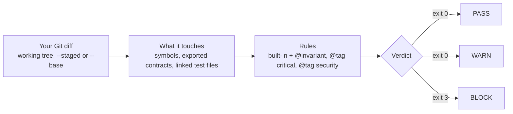

English · [Français](README.fr.md)

# semctx

semctx reads the Git diff of a TypeScript repository and shows which exported contracts, declared
rules and tests the change touches. It ends with one verdict, PASS, WARN or BLOCK. By default BLOCK
exits with code 3, so a Git hook, a CI job or a coding agent can stop the change.

[](https://www.npmjs.com/package/semctx)
[](https://github.com/hoklims/semctx/actions/workflows/ci.yml)
[](LICENSE)

<picture>
  <source media="(prefers-color-scheme: dark)" srcset="docs/assets/readme/hero-dark.svg">
  
</picture>

Analysis runs on your machine. It reads your files and your local Git history, and calls no LLM and
no network service. To try it on your own code, start from a clean working tree in a repository
with at least one commit ([Bun](https://bun.sh) 1.4.0 or newer):

```sh
bunx semctx@latest setup          # once: config and local index
# ...edit some code...
bunx semctx@latest verify diff    # verdict for your uncommitted edits
```

The [quick start](#quick-start) shows the branch check that CI runs.

## What a verdict looks like

The [first-use demo](docs/contributing/first-use-demo.md) uses a small repository with no tests.
Take it at its first commit, run `semctx setup`, then make the demo's three edits. One of them adds
a required field to an exported interface in `src/cart.ts`:

```diff
@@ -1,8 +1,9 @@
 export interface CartTotal {
   subtotalCents: number;
   taxCents: number;
+  discountCents: number;
 }

-export function computeCartTotal(subtotalCents: number, taxCents: number): CartTotal {
-  return { subtotalCents, taxCents };
+export function computeCartTotal(subtotalCents: number, taxCents: number, discountCents: number): CartTotal {
+  return { subtotalCents, taxCents, discountCents };
 }
```

`semctx verify diff` prints this and exits 0:

```text
Verdict: WARN
  range         : working tree
  changed files : 3
  impacted nodes: 7

Impacted contracts
  Exported interface "CartTotal" is a public, compiler-enforced contract. [statically_verified]

Recommended tests
  none

Unknowns
  ? Could not confirm index binding (STALE: ANALYSIS_INPUT_MISMATCH, WORKING_DIFF_MISMATCH); impact is reported without a freshness proof.

Findings
  [WARN ] contract_changed_without_test: exported contract changed without a covering test: CartTotal
```

| In the report | What it tells you |
| --- | --- |
| `Verdict: WARN` | The answer. WARN is advisory, so the exit code is 0. |
| `changed files`, `impacted nodes` | Files in the diff, then the files and declarations whose lines it touches. |
| `Impacted contracts` | Exported interfaces and type aliases the change edits. |
| `[statically_verified]` | How semctx knows: read from the code's structure. `tested` means a test file imports it; `inferred` means it rests on a marker comment. |
| `Recommended tests` | Test files that import any symbol declared in a changed file, touched or not. The demo has none. |
| `? Could not confirm index binding` | The index was built before the edit. Expected when you check uncommitted work. |
| `[WARN ] contract_changed_without_test` | The rule that fired, and the symbol it fired on. |

`computeCartTotal` changed as well, but exported functions raise nothing by default: only exported
interfaces and type aliases count as contracts. The other two edits get no finding either. One
rewords a comment, the other slips an off-by-one into an unexported discount helper;
[Limits](#limits) explains why semctx misses that bug. A
[public summary of the demo's evidence](https://hoklims.github.io/semctx/demo/) is published
online; it shows counts and verdicts, not this raw output.

## How it works



`semctx index` reads your code with the TypeScript compiler API and stores a graph of symbols,
imports, tests and markers in a local, git-ignored index. `verify diff` maps the changed lines onto
that graph, applies the rules, and the most severe finding sets the verdict. The exit codes above
are the defaults (`--fail-on block`).

## Quick start

You need [Bun](https://bun.sh) 1.4.0 or newer and a Git repository with at least one commit. This
flow checks a committed branch against `main`, which is also what the GitHub Action does.

1. Set up once, from a clean working tree (commit or stash first):

   ```sh
   bunx semctx@latest setup
   ```

2. Make your change on a branch and commit it:

   ```sh
   git switch -c try-semctx
   # ...edit code...
   git add -A && git commit -m "my change"
   ```

3. Index that commit, then check the branch against `main`:

   ```sh
   bunx semctx@latest index
   bunx semctx@latest verify diff --base main
   ```

`setup` writes `.semctx/config.json` and six `.sem` templates in `.semctx/semantic/` (comments only
until you write something), updates `.gitignore` and builds the local index. The config and the
templates are meant to be committed, which step 2 does. Re-running `setup` is harmless on a clean,
committed tree. It re-indexes, so never run it on uncommitted edits you are about to verify.

On a small repository `setup` ends with `OK ready (analysis partial)` and a WARN line on stderr.
That is normal; `semctx index-health` lists the reasons.

<details>
<summary>What <code>setup</code> printed on the demo repository (excerpt)</summary>

```text
  ok config    written
  ok semantic  6 file(s) scaffolded (.semctx/semantic/, versioned)
  ·· index     analyzing 3 selected file(s) (typescript:3)…
  ok index     9 nodes, 9 edges, 1 claims
  ok check     model consistent
  !! analysis  partial

TypeScript analysis: 1 worker(s), single
OK ready (analysis partial)
```

And on stderr:

```text
WARN setup succeeded, but incomplete analysis cannot justify negative conclusions; run 'semctx index-health --json' for the exact gates and reasons.
```

</details>

> [!IMPORTANT]
> The index has to describe committed code. Run `semctx index` again after every commit, pull or
> branch switch, otherwise `verify diff` answers BLOCK with `index_binding_stale`. For uncommitted
> work, index a clean tree, edit, then verify without re-indexing in between: re-indexing an edited
> tree can hide a finding.

`--base` needs a ref that exists locally, because semctx never fetches. Use your default branch name
if it is not `main`. To drop the `bunx semctx@latest` prefix, install the CLI once with
`bun add -g semctx@latest`. The rest of this README writes plain `semctx`.

## The three verdicts

<picture>
  <source media="(prefers-color-scheme: dark)" srcset="docs/assets/readme/verdicts-dark.svg">
  
</picture>

The exit code depends on `--fail-on`:

| Verdict | default (`--fail-on block`) | `--fail-on warn` | `--fail-on none` |
| --- | :---: | :---: | :---: |
| PASS | 0 | 0 | 0 |
| WARN | 0 | 3 | 0 |
| BLOCK | 3 | 3 | 0 |

A run that stops before a verdict, for example with no commit or an invalid option value, exits 1.
An unknown command or subcommand exits 2. `--dry-run` only resolves the Git range and the options:
it exits 0 when that works, fails like any other run otherwise, and does not load the config, so a
successful dry run says nothing about `.semctx/config.json`.

These are the rules `setup` writes to `.semctx/config.json`, plus one built-in check:

| Rule | Verdict | Fires when |
| --- | --- | --- |
| `invariant_touched_without_test` | BLOCK | code under an `@invariant` changes with no covering test |
| `critical_contract_changed_without_test` | BLOCK | an exported interface or type alias tagged `@tag critical` or `@tag security` changes with no covering test |
| `security_surface_without_verification` | BLOCK | a symbol tagged `@tag security` changes with no covering test |
| `contract_changed_without_test` | WARN | any other exported interface or type alias changes with no covering test |
| `contradiction_unresolved` | WARN | the change touches a document marked contradicted or deprecated |
| `index_binding_stale` | BLOCK, always | the index was built for a different commit, as after a commit, pull or branch switch (run `semctx index`). With no index at all, the run stops before a verdict and exits 1 |

To relax a rule, set its `severity` to `warn` or remove it
([blocking rules](docs/reference/configuration.md#blocking-rules-and-severity-tiers)). The GitHub
Action applies such a change only through [`config-path`](#github-actions).
`index_binding_stale` cannot be configured. Neither can `analysis_scope_incomplete`, which exists
only with config v2: it blocks when a changed file in scope cannot be analysed, and warns when that
file's analysis is only partial.

### What counts as a covering test

semctx never runs your tests. It checks imports. A test covers a symbol when a test file imports it
by name, directly from the file that declares it:

| Import in a test file, with `greet` declared in `src/index.ts` | Covers `greet` |
| --- | --- |
| `import { greet } from "../src/index";` | yes |
| `import { greet as subject } from "../src/index";` | no, aliased |
| `import * as m from "../src/index";` | no, namespace import |
| `import { greet } from "../src/barrel";` where `src/barrel.ts` re-exports it | no, re-export |

Type-only imports do not count either. A file is a test when its name ends in `.test.ts` or
`.spec.ts` (or the `.tsx`, `.mts`, `.cts` variants), when it sits in a `test/`, `tests/` or
`__tests__` folder, or when it imports `vitest`, `bun:test` or `node:test`.

## Tell semctx what must not break

Without markers in your code, the symbol rules can only raise a WARN, and only for exported
interfaces and type aliases; a changed document marked contradicted or deprecated can also raise a
WARN. The built-in checks still block: `index_binding_stale` when the index
is out of date, and, with config v2, `analysis_scope_incomplete`. To make semctx block on your own
rules, write the rule in a one-line JSDoc tag on the code it protects,
as in [`examples/consumer-typescript-repo`](examples/consumer-typescript-repo/src/index.ts):

```ts
/**
 * @invariant greeting-non-empty: a greeting must never be an empty string
 */
export function greet(name: string): string {
  return `Hello, ${name}!`;
}
```

Commit the marker and run `semctx index`: rules come from the index, and a working-tree check reads
the index built before your edit. Then change the body of `greet` while no test imports it:

```diff
-  return `Hello, ${name}!`;
+  return name.length > 0 ? `Hello, ${name}!` : "";
```

`verify diff` exits 3, and the report contains (excerpt):

```text
Impacted invariants
  ! a greeting must never be an empty string [inferred]

Findings
  [BLOCK] invariant_touched_without_test: invariant-constrained code changed without a covering test: greet
```

This edit really breaks the rule: it returns an empty string for an empty name. semctx cannot see
that. It sees that guarded code changed with no test behind it, and stops the change until a test
exists. To clear the finding, add one that imports `greet` from the file that declares it:

```ts
// test/greet.test.ts
import { expect, test } from "bun:test";
import { greet } from "../src/index";

test("a greeting is never empty", () => {
  expect(greet("")).not.toBe("");
});
```

Commit the code and the test, run `semctx index`, then `semctx verify diff --base main`. The finding
clears and `test/greet.test.ts` appears under `Recommended tests`. Run that test yourself: here it
fails, and that failure is what tells you the rule is broken.

Markers go directly above the declaration they guard:

| Declaration | Marker recognised |
| --- | --- |
| function, or `const`/`let` holding an arrow function or function expression | yes |
| class, interface, type alias, enum | yes |
| method, class property, plain constant | no, silently ignored; mark the class to guard its methods |

`@tag security` on a declaration the table recognises, or `@tag critical` on an exported interface or type alias, arms the two
other BLOCK rules. `@tag critical` on a function arms nothing. semctx only uses markers you write
and never adds any. A marker must fit on one line.

## Where it runs

| Surface | Start with | What you get | Guide |
| --- | --- | --- | --- |
| CLI | `semctx verify diff` | The verdict as text, GitHub annotations (`--format github`) or a versioned JSON report (`--format json`) | [CLI reference](docs/reference/cli.md) |
| GitHub Actions | `uses: hoklims/semctx/packages/github-action@v0.4.2` | An annotation at each symbol a finding names, a job summary and a `verdict` output; BLOCK fails the job | [GitHub Actions](docs/integrations/github-actions.md) |
| Claude Code | `bunx semctx@latest install` | The semctx MCP tools and skills, plus an optional guarded mode that holds `git commit` until the diff is verified | [Claude Code](docs/integrations/claude-code.md) |
| Codex | `bunx semctx@latest install --host codex` | The same MCP tools and skills | [Codex](docs/integrations/codex-control-plane.md) |
| Any MCP client | tool `semctx_verify_change` | The same diff check over MCP, next to the server's other typed tools | [MCP setup](docs/integrations/claude-code.md#mcp-without-the-plugin) |

### GitHub Actions

Copy [`examples/github-actions/semctx.yml`](examples/github-actions/semctx.yml) to
`.github/workflows/`, or let `semctx setup --preset github-claude` write it:

```yaml
name: Semctx
on:
  pull_request:
    types: [opened, synchronize, reopened]
permissions:
  contents: read
jobs:
  semctx:
    runs-on: ubuntu-latest
    steps:
      - uses: actions/checkout@v4
        with:
          fetch-depth: 0   # semctx needs the merge base and never fetches
      - uses: hoklims/semctx/packages/github-action@v0.4.2
        with:
          base: ${{ github.event.pull_request.base.sha }}
          head: ${{ github.sha }}
          fail-on: block
```

The action installs Bun itself, indexes the checked-out commit and verifies the pull request range.
WARN fails the job only with `fail-on: warn`. It needs no secrets and posts no PR comments, and it
never loads `bunfig.toml` or `.env` from the pull request, so a PR cannot run code on the runner
that way. Pin a release tag, because `main` and `stable` move.

The action starts from the default config, not the one committed in `.semctx/`. To apply your own
rules, keep a copy outside `.semctx/` and pass it as `config-path`
([custom config](docs/integrations/github-actions.md#monorepos-and-custom-config)).

<details>
<summary>What the annotations look like</summary>

The demo's WARN, printed with `semctx verify diff --format github`:

```text
::warning title=semctx%3A contract_changed_without_test,file=src/cart.ts,line=1::exported contract changed without a covering test: CartTotal
::notice::semctx verdict WARN — 0 block, 1 warn (range working tree)
```

</details>

### Claude Code and Codex

Run `bunx semctx@latest install` from the repository you want to check. It installs or updates the
semctx plugin for each detected host (Claude Code or Codex must already be installed), then runs
`setup`. `--dry-run` previews the plan, `--host codex|claude|all` picks the hosts, and
`--skip-setup` installs for the machine only. Re-running it is harmless on a clean, committed tree;
because it runs `setup`, which re-indexes, add `--skip-setup` when you have uncommitted edits.

The plugins give the agent the semctx MCP tools and skills, for example `semctx_verify_change` to
check its own diff before it says it is done. The plugin hooks run on Node, so Node must be on your
`PATH` too.

By default the plugins only report. On Claude Code, a `.semctx/guard.json` containing
`{"enabled": true}` turns on [guarded mode](docs/integrations/claude-code-guarded-mode.md):
`git commit` and `git push` are refused until `semctx verify diff --record` has recorded a non-BLOCK
verdict for exactly that content. With nothing recorded, the hook answers
`semctx guarded mode: no verification on record.` Set `SEMCTX_GUARD=off` to turn the mode off.

Codex has no guarded mode. When the Codex agent runs semctx from the shell, it calls a global
`semctx`, so install one with `bun add -g semctx@latest`.

Plugins update from the `stable` branch, which moves only when a release is published to npm.
`semctx plugin-status` shows the version you have.

<details>
<summary>Tested host versions</summary>

<!-- semctx:compatibility:start -->
Semctx **0.4.2** requires **Bun >=1.4.0**.
The supported, tested host baseline is **Codex 0.147.0** and
**Claude Code 2.1.229**. Other host versions are **unknown** until tested;
these pins do not claim the earliest historically compatible versions.
[Baseline delivery evidence](https://github.com/hoklims/semctx/actions/runs/34664142432).
Installation does not reload an active session: open a new Codex task, or run
`/reload-plugins` in Claude Code (restart if reload fails).
<!-- semctx:compatibility:end -->

</details>

### Other MCP clients

Other MCP clients can run the server from a source checkout
([config snippet](docs/integrations/claude-code.md#mcp-without-the-plugin)). The server registers
39 schema-declared tools (typed inputs and outputs), listed in
[`tool-contract.ts`](packages/mcp-server/src/tool-contract.ts). Tools that read a repository take
its absolute path as `repositoryRoot`. `SEMCTX_ROOT`, if set, must be absolute.

## Limits

semctx reads your code. It never builds it and never runs your tests, so treat a report as a list
of what to re-check.

- A behaviour change inside a function gives no finding unless a marker covers it. In the demo, the
  off-by-one in `src/pricing.ts` is a real bug and gets no finding, because nothing marks that code.
- An empty report does not prove that nothing was affected. When the index reports
  `analysis partial`, as it does on the demo, semctx does not claim it found every reference to your
  code. Calls that cannot be resolved statically are left out, runtime behaviour such as races is
  out of reach, and `Unknowns` lists only a few known gaps.
- It sees what `git diff` sees. Untracked files are ignored until you `git add` them (`git add -N`
  is enough). Working-tree and `--staged` checks also skip symbols declared in a brand-new file:
  commit, index and use `--base` to check those.
- `verify diff --from-file <patch>` always returns BLOCK with `index_binding_stale`, because a patch
  file does not record which commit it came from. Verify changes in the repository itself.
- Languages: TypeScript (`.ts`, `.tsx`, `.mts`, `.cts`) by default; declaration files (`.d.ts`)
  are skipped, so a changed public declaration there raises nothing. Python through 3.12 is opt-in
  with config v2 (`semctx setup --polyglot`) and limited to modules, classes, functions, imports and
  markers, with no calls and no test links. Markdown and SQL files are only classified as documents
  and migrations. Files in other languages are skipped unless config v2 selects them: a selected
  file that no analyzer supports makes `verify diff` BLOCK with `analysis_scope_incomplete` when it
  changes.
- Links from `.sem` files name a file and a symbol, so renaming either can mark them stale.
  `semctx migrate anchors --apply` rewrites older links that still carry line numbers.
- It does not search code or pick the files an agent should read. Grep and embedding search do that
  better ([ADR 0005](docs/adr/0005-context-retrieval-pipeline-rejected.md)).

## Current delivery status

semctx is pre-1.0 (0.4.x). The CLI, both plugins and the GitHub Action share one version and ship
together from one release tag. Pin an exact version when you need reproducible results. Minor
releases can still contain breaking changes; the [changelog](CHANGELOG.md) lists them.

| Status | What |
| --- | --- |
| Released | `verify diff`, `impact diff`, the GitHub Action, the Claude Code and Codex plugins, the MCP server, change records and the planning tools |
| Opt-in | config v2 (`setup --polyglot`) and guarded mode on Claude Code |
| Experimental | the [Oh My Pi](docs/integrations/omp.md) package and `context prepare` (`semctx_prepare_task` over MCP); [Grok](docs/integrations/grok.md) can load the Claude Code plugin but is outside the tested host baseline |
| Partial | agent checkpoints, of which only `before_completion` is automated ([reference](#for-agent-integrators), [#28](https://github.com/hoklims/semctx/issues/28)) |
| Withdrawn | the task-to-files retriever, which lost to plain BM25 search ([ADR 0005](docs/adr/0005-context-retrieval-pipeline-rejected.md), [results](benchmarks/change-impact-eval/RESULTS.md)); `context prepare` is what is left of it |
| Not built | anything that applies a plan for you |
| Not measured | accuracy: the [public replay corpus](docs/pilot/public-corpus-2026-09-08.json) has 30 real changes, none with a known expected result yet, so none is scored |

Planned work is in the [roadmap](ROADMAP.md).

## Reference

<details>
<summary>CLI cheat sheet</summary>

```sh
semctx verify diff                                      # uncommitted changes against HEAD
semctx verify diff --staged                             # what the next commit contains
semctx verify diff --base main                          # your branch, from its merge-base
semctx verify diff --fail-on warn                       # exit 3 on WARN as well
semctx verify diff --format json --output report.json   # versioned JSON report
semctx verify diff --dry-run                            # resolved Git range and options, no analysis
semctx impact diff --base main                          # what the change can reach, no verdict
semctx index                                            # rebuild the index for the current commit
semctx status                                           # is the index still fresh?
semctx index-health                                     # why the analysis is partial
```

Write options after the command: in `semctx --json status`, `--json` swallows `status` and the CLI
prints the general help. `semctx --help` lists every command with its main options, and the
[CLI reference](docs/reference/cli.md) has the rest.

A pre-commit hook can run `semctx verify diff --staged` against an index built at the current clean
HEAD ([example](docs/examples/pre-commit-hook.md)). Re-index after each commit, pull or checkout,
outside the pre-commit hook. On Claude Code with guarded mode, `semctx verify hook pre-commit` is the
project-managed alternative.

For a larger change, `semctx change open change.<slug> --preserves <invariant-ids>` records which
invariants the change must keep, and `--requires <evidence-ids>` the evidence it still owes.
`semctx change verify change.<slug>` later runs `verify diff` against that record. A record opened
without either flag checks nothing beyond `verify diff`
([walkthrough](docs/examples/semantic-layer-reservation-example.md)).

</details>

<details>
<summary>Configuration</summary>

`.semctx/config.json` holds the file selection and the rules. Commit it, together with
`.semctx/semantic/`, where you can write goals, invariants, decisions, assumptions, evidence and
unknowns in plain `.sem` files. The index itself stays local and git-ignored.

- Rules: each one maps a condition to a severity, `block` or `warn`. To make WARN fail, use
  `--fail-on warn` (`fail-on: warn` in the GitHub Action) rather than editing the rules
  ([blocking rules](docs/reference/configuration.md#blocking-rules-and-severity-tiers)).
- Version 1, the default, analyses every `.ts`, `.tsx`, `.mts`, `.cts`, `.md`, `.mdx` and `.sql`
  file outside `node_modules`, `.git`, `.semctx`, `dist`, `build`, `coverage`, `.turbo` and `.next`,
  except that TypeScript declaration files (`.d.ts`) yield no symbols.
  It does not apply its `include` and `testGlobs` fields, and it matches `exclude` as a plain
  substring.
- Version 2 (`semctx setup --polyglot`) applies `include` and `exclude` as globs and adds Python. An
  existing v1 config converts through a reviewed plan
  ([config migration](docs/reference/configuration.md#config-migration-v1-to-v2)).

The [configuration reference](docs/reference/configuration.md) documents every field.

</details>

## For agent integrators

<details>
<summary>Planning tools, agent checkpoints and the lifecycle hook</summary>

You need this only to build or tune an agent workflow; the plugin skills already follow it.

The planning tools check that the index is fresh, follow code up to the intent written in
`.semctx/semantic/`, and compare a real diff with a plan. On the CLI they are `semctx status` and
`semctx control ...`; over MCP, `semctx_control_status`, `semctx_control_trace`,
`semctx_control_plan` and the other `semctx_control_*` tools. Most only read. Two write:
`control target-propose` saves a target architecture artifact under `.semctx/semantic/targets/`, and
`control handoff` stores a handoff capsule in git-ignored local state. One MCP tool reads no
repository and takes no `repositoryRoot`: `semctx_control_verify_authorization`, which checks a
sealed change-authorization capsule offline ([design](docs/architecture/change-authorization-v1.md)).

A `READY` plan grants no execution authority: these tools never edit code, commit, delete or deploy
([design](docs/architecture/control-plane-v1.md)).

Both plugins expose `semctx_control_agent_lifecycle`, a read-only checklist tool. Each call carries
a `requiredAltitude`, which says how high-level the work is, from L0 (diff hunks) to L6 (strategy).
The agent calls it at four points:

- `before_implementation_write`, before its first write at L2 (component level) or above;
- `after_repository_edits`, after editing, with the ids of what it touched;
- `before_completion`, before saying the work is done;
- `before_compaction`, before compacting its context or handing the work over.

The answer is `NO_OP` (nothing required, as for pre-write work at L0 or L1), `RECORDED` (every
required step was reported) or `INCOMPLETE` (some are missing). It checks that the steps were
reported, not what they found.

semctx takes touched ids on the agent's word (`caller_observed_advisory`) and keeps nothing between
calls (`stateless_caller_reinjected_unbound`), so the agent resends earlier ids on every call.

Each plugin ships one lifecycle hook that automates only the before_completion checkpoint. It
records which semctx MCP tools ran, as step ids in a git-ignored file, and reports on stderr at the
end of a turn when that set changed.

It never blocks. From the host event it uses only the event name, session id, working directory and
tool name, and it never opens the transcript or reads source code. Set `SEMCTX_LIFECYCLE=off` to
turn it off.

The hook sees MCP calls only, so a step run through the shell CLI shows as missing. The other three
checkpoints have no automatic host hook ([details](docs/integrations/claude-code.md#lifecycle-foundation)).

</details>

## Documentation and help

The [documentation index](docs/README.md) lists every guide. Start with
[getting started](docs/getting-started.md) or [troubleshooting](docs/troubleshooting.md); the
[architecture overview](docs/architecture/overview.md) and the [design decisions](docs/adr/) explain
how the pieces fit.

To run the demo from a checkout: `bun install --frozen-lockfile`, then
`bun scripts/first-use-demo.ts --cli apps/cli/src/index.ts --out demo-evidence` (a new directory),
then open `demo-evidence/report.md`.

Contributors start with the [first contributor check](docs/contributing/first-check.md) and
[CONTRIBUTING.md](CONTRIBUTING.md). Questions and bug reports go through [SUPPORT.md](SUPPORT.md),
vulnerabilities through [SECURITY.md](SECURITY.md). `semctx support` and `semctx feedback` stay on
your machine and upload nothing ([details](docs/reference/cli.md#local-feedback-and-support-reports)).

semctx is licensed under [Apache-2.0](LICENSE).
